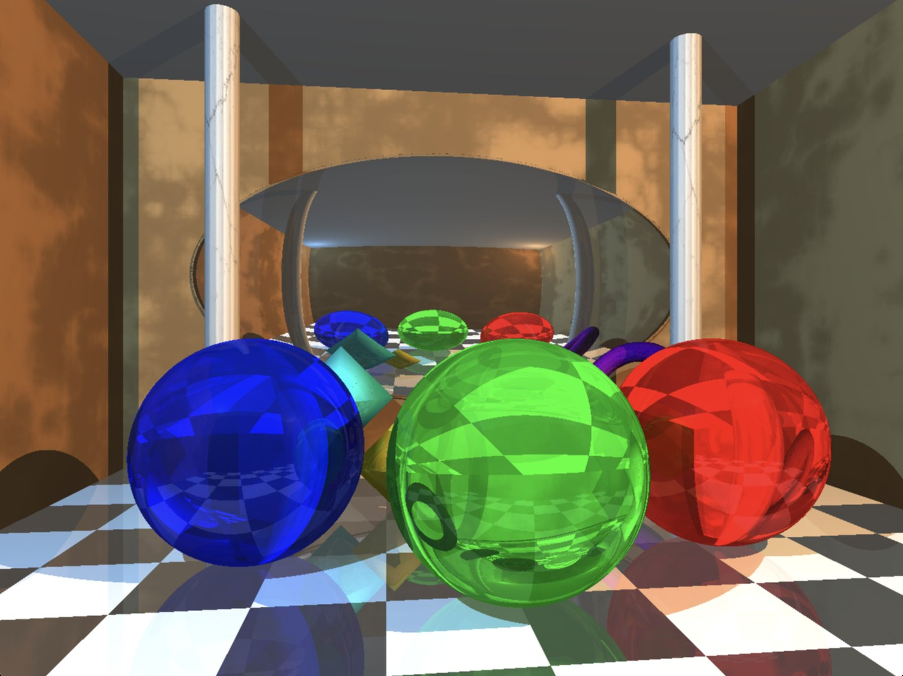

# Ray Tracer

A recursive ray tracer in C++, built on top of a scene graph framework, rendering a marble room full of reflective and refractive gems.



Project 1 for JHU EN.605.767 Applied Computer Graphics (Spring 2026). More details on my [portfolio](https://bryancgarry.github.io/projects/ray-tracer.html).

## Features

- **Recursive tracing:** reflection and refraction rays traced up to a maximum depth, with adaptive termination once a ray's contribution falls below a threshold.
- **Scene graph traversal:** rays walk the same scene graph used for rasterization, carrying matrix, material, and texture state down the tree.
- **Analytic intersection:** spheres, quads, ellipsoids, and finite cylinders, with rays transformed into each object's local space through its inverse modeling matrix.
- **Triangle meshes:** Möller–Trumbore ray/triangle intersection, tested against a local bounding box first.
- **Bounding hierarchy:** AABB nodes group objects so rays that miss a group skip all of its children.
- **Lighting:** Phong shading with shadow rays, refraction via Snell's law, and two colored lights.
- **Textures:** UV image texturing plus procedural checkerboard and Perlin noise marble textures.

## My Code

Built on the course's scene graph framework. The files I wrote or changed:

| Area | Files |
|---|---|
| Ray tracer core and scene | `RayTracer/main.cpp`, `RayTracer/ray_tracer.hpp/.cpp` |
| Intersectable objects | `RayTracer/rt_sphere_node`, `RayTracer/rt_quad_node`, `RayTracer/rt_ellipsoid_node`, `RayTracer/rt_cylinder_node` (`.hpp/.cpp`) |
| Procedural textures | `RayTracer/checkerboard_texture.hpp/.cpp`, `RayTracer/marble_texture.hpp/.cpp`, `geometry/noise.hpp/.cpp` |
| Ray and bounding geometry | `geometry/ray3.hpp/.cpp`, `geometry/aabb.hpp/.cpp`, `geometry/bounding_sphere.hpp/.cpp` |
| Scene graph changes | `scene/camera_node`, `scene/scene_state`, `scene/geometry_node`, `scene/tri_surface`, `scene/textured_tri_surface`, `scene/transform_node`, `scene/bounding_aabb_node`, `scene/bounding_sphere_node` (`.hpp/.cpp`) |

The full write-up I submitted is in [`ReadMe.txt`](ReadMe.txt).

## Building

The project uses the course framework's CMake build. Third-party libraries are **not** included in this repo: SDL3, Assimp, zlib, stb, and GLEW on Windows.

1. Put the prebuilt libraries in `lib/<platform>/` (for example `lib/macos/SDL3.framework`, `lib/macos/assimp`) and their headers in `include/` (`include/SDL3`, `include/assimp`, `include/stb`).
2. Generate and build:
   ```bash
   mkdir build && cd build
   cmake .. -G Xcode
   ```
3. Open the generated project and run the **RayTracer** target.

Developed and tested on macOS with Xcode.
